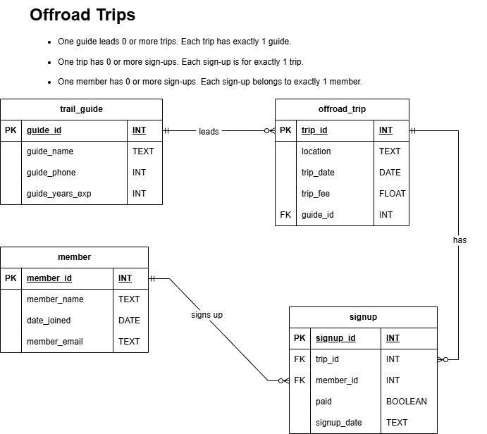

# Offroad Trips

**Live site:** https://your-app-name.onrender.com <!-- TODO: replace with your Render URL after deploying -->
**Built by:** Maricruz Johal, CIS 4720
**Code:** https://github.com/marijohal/Offroad_Trips

Offroad Trips keeps track of guided off-road trips across the USA: where and when each trip runs, what it costs, which trail guide leads it, and which club members have signed up and paid. An off-road club organizer would use it to plan trips, assign guides, and see who is going.

**Database design**

| Table | What one row is |
|---|---|
| trail_guide | One trail guide, with their phone number and years of experience |
| offroad_trip | One scheduled trip: its location, date, fee, and the guide who leads it |
| member | One club member, with their email and the date they joined |
| signup | One member signed up for one trip, with the signup date and whether they paid |

**Extras (CIS 4720)**

- **View `trip_list`:** every trip joined with its guide's name, newest first. The Browse page reads from it.
- **Trigger `check_trip_date`:** blocks adding a trip dated more than 2 years past the current year.

---

## About this starter

This is a small Flask web app where **you write the database and the SQL**. The Python and the web pages are already done. Every page runs one SQL file that you write:

| Page | What it shows | Your SQL file |
|---|---|---|
| Home | Numbers across the top | `queries/stats.sql` |
| Browse | Every item, as a table | `queries/list.sql` |
| Detail | One item, plus related rows | `queries/detail.sql`, `queries/detail_related.sql` |
| Search | Items matching the search words | `queries/search.sql` |
| Report | A summary with GROUP BY | `queries/report.sql` |
| Add | A form that inserts a new row | `queries/add.sql` (plus `settings.py`) |

Underneath them all are `schema.sql` (your tables) and `seed.sql` (your sample rows). The app builds a fresh SQLite database from those two files every time it starts.

It comes with a finished example, **Valley Library**, in `projects/library_example`. You will build the same set of pages for a topic you choose, in `projects/my_project`.

## The guide

Work through these in order. Each one is a numbered list of steps.

1. [Before you start](docs/01-before-you-start.md): install the tools and make your accounts
2. [Get your copy](docs/02-get-your-copy.md): copy this starter to your GitHub and open it in VS Code
3. [Run the example](docs/03-run-the-example.md): start the app and see how the pages and SQL files fit together
4. [Write your SQL](docs/04-write-your-sql.md): plan your topic, then fill in each file
5. [Save to GitHub](docs/05-save-to-github.md): commit and push your work
6. [Deploy to Render](docs/06-deploy-to-render.md): put your site on the internet for free
7. [Add it to your Capstone page](docs/07-add-to-capstone-page.md): showcase it on the class site
8. [Troubleshooting](docs/08-troubleshooting.md): fixes for the problems students hit most

## Commands you will use

Run these in the VS Code terminal, inside this folder.

| Command | What it does |
|---|---|
| `python app.py` | Starts the website at http://127.0.0.1:5000 (stop it with Ctrl + C) |
| `python check.py` | Checks your project against every requirement |
| `python try_sql.py scratch.sql` | Runs the SQL in a file and prints the result as a table |
| `python try_sql.py projects/my_project/queries/detail.sql id=3` | Runs a query file with a value for its placeholder |

On a Mac, type `python3` instead of `python`.

## Requirements checklist

`python check.py` tests most of these for you.

- [x] A topic of your own, with `settings.py` filled in
- [x] At least 3 tables in third normal form, each with a primary key
- [x] At least 2 foreign keys linking the tables
- [x] At least 10 rows in every table
- [x] All seven query files written, and every page working
- [x] Search uses the `:term` placeholder (never text pasted into the SQL)
- [x] An ER diagram saved as `erd.png` and shown in this README
- [x] **CIS 4720:** at least one view and one trigger
- [x] Every SQL statement has a short comment above it, in your own words
- [x] The top of this README filled in
- [ ] Your work pushed to GitHub, deployed on Render, and added to your Capstone page
